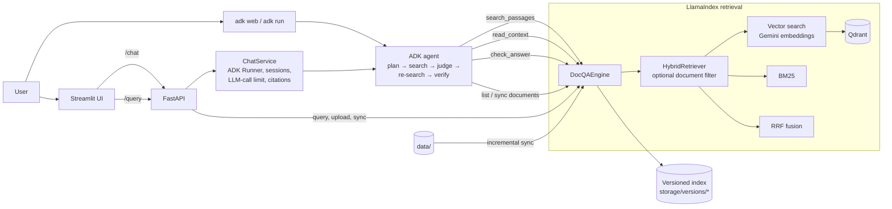

# DocQA – Vietnamese Agentic RAG (Google ADK + LlamaIndex + Qdrant)

An **agentic RAG** assistant that answers questions about internal documents (PDF, DOCX, Markdown, TXT) **in Vietnamese, with citations**, and says *"Tôi không tìm thấy thông tin này trong tài liệu đã cung cấp."* when the documents do not contain the answer.

- **Agentic layer (Google ADK):** the agent plans sub-questions, searches for evidence, judges whether it is sufficient, re-searches (rephrased or within one document), reads neighbouring context, and verifies its own draft before answering. Every step is visible in the API response and the UI.
- **Retrieval layer (LlamaIndex + Qdrant):** incremental ingestion, hybrid retrieval (dense vectors + BM25 fused with Reciprocal Rank Fusion), per-document filtering, versioned crash-safe index.
- **Product layer:** FastAPI REST API, Streamlit chat UI, CLI, Docker Compose, GitHub Actions CI.
- **Quality:** a labelled Vietnamese evaluation set (51 questions: single-hop, multi-hop and out-of-scope) and an evaluator that compares agentic RAG with one-shot RAG on accuracy, rejection, citations, **cost (LLM calls)** and latency.

## Architecture



### Agentic RAG loop (`POST /chat`, `adk web`)

```text
question ─► plan: rewrite follow-ups, split multi-part questions into sub-questions
          ─► for each sub-question:
               search_passages(query[, document]) ─► evidence passages with ids
               judge: enough to answer?
                 no ─► rephrase / restrict to one document / read_context(passage_id) ─► search again (≤ 3)
          ─► draft answer citing passages as [#id]
          ─► check_answer(draft): cited ids must exist; an LLM judge flags unsupported claims
          ─► revise, reply; the chat layer renumbers [#id] → [1], [2] and returns the steps taken
```

Guardrails: the tools return **evidence, never answers**; citations to passages the agent never retrieved are dropped; a per-turn LLM-call limit (`AGENT_MAX_LLM_CALLS`) stops runaway loops; refusals happen only after a search returns nothing.

### One-shot RAG (`POST /query`, CLI `docqa ask`)

Kept as a cheaper baseline (one retrieval, one LLM call) and for comparison in the evaluation:

1. Retrieve `CANDIDATE_TOP_K` chunks with the vector retriever and with BM25, fuse them with RRF and keep `TOP_K`.
2. If the best cosine similarity is below `MIN_SIMILARITY`, return `not_found` **without calling the LLM**.
3. Otherwise prompt the LLM with numbered excerpts. The prompt forbids outside knowledge, requires `[n]` citations and treats excerpts as data (prompt-injection guard).
4. Post-process: detect refusals, map `[n]` back to sources and report latency per stage.

More detail: [docs/architecture.md](docs/architecture.md) and [docs/design-decisions.md](docs/design-decisions.md).

## Features

| Area | What is implemented |
|---|---|
| Ingestion | `.pdf` `.docx` `.md` `.txt`, recursive folders, stable document ids (`path::part`), content hashing |
| Incremental sync | Only new or changed files are embedded; deleted files are removed; unreadable files are reported and keep their previous version |
| Safe persistence | Each write creates a new index version and `CURRENT` is switched atomically; a failed rebuild never breaks the serving index; other processes hot-reload the new version |
| Config-aware index | Changing the embedding model or chunking triggers an automatic rebuild (index fingerprint) |
| Structure-aware chunking | `CHUNK_STRATEGY=structure`: Word heading styles, Markdown `#` and numbered headings (`2.1`, `Chương II`, `Điều 5`) split documents into sections; tables become one `header: value` line per row (merged cells handled), captioned tables are their own chunks; the heading path is embedded and indexed with every chunk and shown in citations; documents without structure (notes, transcripts, slide decks) use **semantic chunking** instead (`STRUCTURE_FALLBACK`) |
| Semantic chunking | Kamradt-style percentile breakpoints on the cosine distance between consecutive sentence windows; PDF line breaks re-joined and list items kept as sentences before splitting; oversized groups re-split and tiny ones merged within the chunk size; embeddings go through the quota-aware path. Available alone (`CHUNK_STRATEGY=semantic`) for comparison, but used by default only where there is no structure: on the eval corpus that costs 132 extra embeddings instead of 1,117 |
| Image understanding | `IMAGE_CAPTIONS=true`: images in PDFs and Word figures are described once by the multimodal LLM (visible text transcribed verbatim, then explained) and inserted where the image was, so image-only slides and diagrams become searchable and citable by page or section. Decorations are filtered before any call (images repeated on several pages, icons), the model flags decorative images, descriptions are cached on disk by image hash, a per-file budget caps calls, and quota errors never fail ingestion |
| Retrieval | `vector`, `bm25` or `hybrid` (RRF, with each retriever's #1 guaranteed a slot) modes; Vietnamese stop words, no English stemming; short pages merged to avoid noise chunks |
| Vector stores | `simple` (LlamaIndex JSON, zero setup) or `qdrant`: server mode via `QDRANT_URL` (Docker Compose) or embedded mode; one collection per index version, orphan collections cleaned up, missing collection triggers a rebuild |
| Models | Google Gemini (default) or fully local Ollama for the LLM and embeddings |
| Grounding | Similarity gate, strict prompt, refusal detection, citation extraction |
| Agentic RAG | ADK agent with `search_passages` (optional per-document filter), `read_context`, `check_answer`, `list_documents`, `sync_documents`; multi-step plan / judge / re-search / verify loop; passage citations renumbered for display; per-turn LLM-call limit; full rebuild is **not** exposed to the LLM |
| API | `/query`, `/chat` (multi-turn), `/documents` upload/list/delete, `/index/sync`, `/index/rebuild`, `/stats`, `/health`; optional `X-API-Key` for write endpoints; upload type, size and path-traversal checks |
| Tooling | CLI, Streamlit UI, Docker Compose, CI (ruff + pytest on Python 3.12/3.13 + Docker build) |
| Quota handling | Embeddings are sent in batches; per-minute 429s are waited out using the provider's `retry in …` hint, while daily-quota errors fail fast with a clear error |
| Tests | 124 offline tests with deterministic fake embeddings/LLM, including the real ADK runtime driven by a scripted model |

## Quickstart

Requirements: Python 3.11+ and a Gemini API key ([Google AI Studio](https://aistudio.google.com/app/apikey)), or [Ollama](https://ollama.com) for a fully local setup.

```bash
python -m venv .venv
# Windows: .venv\Scripts\activate    Linux/macOS: source .venv/bin/activate
pip install -e ".[dev,ui,qdrant]"    # add ,ollama for local models
cp .env.example .env                 # then set GOOGLE_API_KEY
```

Index the demo documents (a fictional company in `data/demo/`) and ask a question:

```bash
docqa rebuild
docqa ask "Định mức khách sạn khi công tác ở TP.HCM là bao nhiêu?"
```

```text
Định mức khách sạn tại Hà Nội và TP. Hồ Chí Minh tối đa 1.200.000 đồng mỗi đêm [1].
 *[1] demo/quy_trinh_cong_tac_va_hoan_ung.md  score=0.0325
```

*(Illustrative output: the wording depends on the model.)*

### Run the chat UI

```bash
docqa serve                              # REST API at http://127.0.0.1:8000 (docs at /docs)
streamlit run ui/streamlit_app.py        # UI at http://localhost:8501
```

### Run with the ADK developer UI or CLI

```bash
adk web agents                 # pick "docqa_agent"
adk run agents/docqa_agent
```

### Run with Docker

```bash
docker compose up --build      # Qdrant on :6333, API on :8000, UI on :8501; reads .env
```

### Fully local with Ollama

```bash
ollama pull qwen2.5:7b && ollama pull embeddinggemma
# .env
LLM_PROVIDER=ollama
LLM_MODEL=qwen2.5:7b
EMBED_PROVIDER=ollama
EMBED_MODEL=embeddinggemma
```

The ADK agent itself still uses `ADK_MODEL` (Gemini). `docqa ask`, `/query` and the "RAG trực tiếp" mode of the UI run fully locally.

## Example questions

| Question | Expected behaviour |
|---|---|
| Sinh viên thực tập từ mấy giờ đến mấy giờ? | Mon–Fri, 8:30–17:30 `[n]` |
| Ngày phép chưa dùng hết có được chuyển sang năm sau không? | Up to 5 days, must be used before 31/03 `[n]` |
| Phụ cấp trực hệ thống mỗi tuần là bao nhiêu? | 1.000.000 đồng per on-call week (answer comes from the **.docx** file) |
| *(agent, follow-up)* "Còn sự cố P1 thì phải xác nhận trong bao lâu?" | Agent rewrites into a standalone query → 15 minutes |
| Tài liệu có nói về lương thực tập không? | `not_found` |
| Thủ đô của nước Pháp là gì? | `not_found` (out of scope) |

## Evaluation

Evaluation has three layers, because no public benchmark covers every part of the system:

| Layer | Data | Metrics |
|---|---|---|
| Retrieval | **Zalo AI 2021 Legal Text Retrieval** (public, human-labelled; BEIR format) | nDCG@10, MRR@10, Recall@k, with 95% bootstrap CIs |
| Answers and refusal | UIT-ViQuAD 2.0 in an open-domain setting (in progress) | EM/F1, correct-refusal rate |
| Document processing (tables, sections, figures, Word/PDF) | Own tagged set, because public benchmarks ship pre-segmented text | Hit@1, Hit@k, MRR per question type |

### Public benchmark: Zalo AI 2021 Legal Text Retrieval

```bash
# Data: https://huggingface.co/datasets/GreenNode/zalo-ai-legal-text-retrieval-vn (MIT), into data/benchmarks/zalo_legal
docqa bench data/benchmarks/zalo_legal --modes bm25                       # full corpus, no API cost
docqa bench data/benchmarks/zalo_legal --modes bm25,vector,hybrid \
            --queries 100 --distractors 1500 --seed 42                    # reproducible subset for dense retrieval
```

Each legal article is one passage, as in BEIR, so these numbers measure retrieval, not chunking. Full corpus: 61,425 articles, 788 labelled test queries.

| Retriever | nDCG@10 | MRR@10 | Recall@1 | Recall@5 | Recall@10 | Recall@100 |
|---|---|---|---|---|---|---|
| BM25 (syllables, Vietnamese stop-words) | 0.628 [0.602–0.654] | 0.562 | 0.417 | 0.757 | 0.834 | 0.968 |

Dense and hybrid retrieval need one embedding per passage, so they are evaluated on a seeded subset: all relevant articles of the sampled queries plus random distractors. Subset scores compare our own configurations and are not comparable with full-corpus results. Passage embeddings are cached on disk, so a run interrupted by a daily quota resumes without re-embedding.

### Public benchmark: chunking measured at token level (UIT-ViQuAD 2.0)

Hit@k does not penalise irrelevant text inside a chunk. Following Chroma's *Evaluating Chunking Strategies for Retrieval* (2024), chunking is also measured token by token against human-labelled spans. Data: the UIT-ViQuAD 2.0 validation split (VLSP 2021; mirror `taidng/UIT-ViQuAD2.0`; the test split has no public answers). The 19 Wikipedia articles are rebuilt from their paragraphs, and the ground-truth excerpt of each of the 2,653 answerable questions is the sentence containing its annotated answer.

```bash
docqa chunk-bench data/benchmarks/viquad2/data/validation-00000-of-00001.parquet
```

| Chunking | Chunks | Tokens/chunk | Precision Ω | Recall@5 (BM25) | IoU@5 |
|---|---|---|---|---|---|
| **paragraph boundaries** | 557 | 365 | **0.222** | **0.918** | 0.038 |
| sentence 128 / overlap 0 | 2,121 | 96 | 0.705 | 0.767 | 0.117 |
| sentence 256 / 0 | 961 | 212 | 0.360 | 0.858 | 0.062 |
| sentence 256 / 64 | 1,086 | 211 | 0.345 | 0.866 | 0.062 |
| sentence 512 / 0 | 443 | 459 | 0.167 | 0.901 | 0.030 |
| sentence 512 / 64 (previous default) | 468 | 457 | 0.165 | 0.909 | 0.030 |
| sentence 512 / 128 | 539 | 459 | 0.152 | 0.910 | 0.030 |
| sentence 1024 / 0 | 219 | 929 | 0.083 | 0.924 | 0.015 |

- **Natural boundaries beat fixed-size splitting on both axes.** Paragraph chunks are smaller than 512-token chunks yet have higher recall (0.918 vs 0.909) and higher Precision Ω (0.222 vs 0.165). This is public-data evidence for splitting on the document's own boundaries, the idea behind structure-aware chunking.
- **Overlap barely helps.** Going from 512/0 to 512/128 adds 22% more chunks for +0.9 points of recall and lowers Precision Ω, consistent with Chroma's findings.
- **Size is a trade-off, not an optimum.** Small chunks maximise precision and IoU, large ones maximise recall. IoU is read together with recall and answer quality, because tiny chunks starve the LLM of context.
- Wikipedia text has paragraphs but no headings, so this benchmark cannot compare heading-based structure-aware chunking; the own evaluation set below covers that, plus tables, figures and Word/PDF parsing.

### Own evaluation set

```bash
docqa eval                                  # retrieval for vector/bm25/hybrid + answers + calibration
docqa eval --retrieval-only                 # embeddings only, no LLM cost
docqa eval --judge                          # + LLM-as-judge faithfulness
docqa eval --agent --kinds multi_hop,unanswerable --delay 4   # agentic vs one-shot RAG
```

The dataset [eval/dataset.jsonl](eval/dataset.jsonl) has 51 questions:
- 34 **single-hop** questions, each with the expected source file, the evidence phrase the retrieved chunk must contain, and the answer keywords.
- 10 **multi-hop** questions that need facts from two documents, or from different sections of one document.
- 7 **unanswerable** questions.

Reports are written to `eval/results/eval-<timestamp>.md|json`, with:

- **Retrieval**: Hit@k and MRR@k per mode, plus the list of missed questions.
- **Answers**, for one-shot RAG and (with `--agent`) agentic RAG side by side: accuracy overall and per question kind, correct-rejection rate, false-rejection rate, citation rate, faithfulness, p50/p95 latency and **cost**: LLM calls and searches per question, and how often the agent verified its answer.
- **Similarity calibration**: score distributions of answerable vs. unanswerable questions and a suggested `MIN_SIMILARITY`. The scale depends on the embedding model (Qdrant and the `simple` store both report cosine similarity), so calibrate after changing it.

### Results: structure-aware chunking on a hard corpus

The demo corpus is too easy to compare chunking strategies (Hit@4 is already 100%). A second, private eval set (`eval/private/`, not committed because it uses a private thesis proposal and third-party lecture slides) has 56 answerable and 6 unanswerable questions over a 30-page Vietnamese `.docx` (46 headings, 12 tables) and a 49-slide RAG lecture `.pdf`. Each question is tagged by where its answer lives, and the set was written and validated **before** the new chunker existed. Hybrid retrieval, top-5:

| Question tag | n | Hit@1 sentence → structure | Hit@5 sentence → structure | MRR@5 sentence → structure |
|---|---|---|---|---|
| text | 30 | 80.0% → **90.0%** | 100% → 100% | 88.3% → **93.9%** |
| table | 12 | 66.7% → **83.3%** | 91.7% → **100%** | 75.0% → **91.7%** |
| section (question names a heading) | 7 | 57.1% → **100%** | 85.7% → **100%** | 67.1% → **100%** |
| image (answer only inside a figure) | 7 | 0% → 0% | 0% → 0% | 0% → 0% |
| **all** | 56 | 64.3% → **78.6%** | 83.9% → **87.5%** | 71.8% → **82.4%** |

- Every miss of the old chunker was caused by lost structure: a list separated from its heading ("Must-have"), a table without its caption, table cells detached from their row and column, a database-schema chunk without its section, so lecture slides about "embeddings" outranked it.
- Vector-only retrieval gained the most (Hit@1 53.6% → 71.4%): the heading path gives the embedding the context the chunk text lacks.
- Cost: 133 chunks instead of 102 (+30% embeddings), because sections are shorter than 512 tokens.
- Inspecting the output before measuring caught a bug the metrics would have missed: merged-cell de-duplication by *text* dropped one of two adjacent "Có" cells and shifted every following column. Cells are now de-duplicated by XML element.
- Regression check on the easy demo corpus (BM25-only, measured offline): Hit@4 unchanged at 100%, Hit@1 100% → 97.1% (one genuinely ambiguous question, not tuned away). The hybrid check is pending; `sentence` stays the default until it passes.
- **Images are the next gap**: no chunker can retrieve text that was never extracted. Image-only slides and figures need captioning at ingestion.

### Results (retrieval, `gemini-embedding-2`, chunk size 512)

Demo corpus: 6 documents → 12 chunks; 34 answerable questions.

| Mode | Hit@1 | Hit@4 | MRR@4 |
|---|---|---|---|
| vector | 91.2% | 97.1% | 94.1% |
| bm25 | **97.1%** | **100%** | **98.5%** |
| hybrid (RRF) | 94.1% | 100% | 96.6% |

Findings:

- **BM25 beats dense retrieval on this corpus.** Policy questions hinge on exact tokens (amounts, durations such as "5 phút" or "24 giờ"), which keyword matching handles better than embeddings. Plain RRF gives both retrievers equal weight, so hybrid inherits some vector mistakes at rank 1. The next experiment is a weighted fusion and/or a reranker.
- **The similarity gate is only a cost filter.** Best-match cosine scores overlap between answerable (min 0.574) and unanswerable questions (max 0.668), so no threshold separates them cleanly. `MIN_SIMILARITY=0.55` never rejects an answerable question, and the LLM's grounded refusal is the real safeguard.
- **Caveat:** with only 12 chunks, Hit@4 retrieves a third of the corpus, so Hit@1 and MRR are the informative metrics. A larger corpus is needed for stronger claims.

### Results: agentic vs one-shot RAG (Gemini `gemini-3.5-flash-lite`, Qdrant)

| Experiment | System | Accuracy | LLM calls / question | Latency p50 |
|---|---|---|---|---|
| 10 multi-hop, `TOP_K=4` | one-shot RAG | 100% | 0.94 | 4.3 s |
| | agentic RAG | 100% (8/8, 2 API 503 errors) | 4.1 | 23.3 s |
| 10 multi-hop, `TOP_K=2` | one-shot RAG | 90% | 1.0 | 1.5 s |
| | agentic RAG | **100%** | 3.5 | 17.0 s |
| 7 unanswerable, `TOP_K=4` | one-shot RAG | 100% correct rejection | 0.86 | 1.8 s |
| | agentic RAG | 100% (6/6, 1 API 503 error); 71% before the fixes below | 4.3 | 18.3 s |

What the numbers say:

- **On this small corpus the agent rarely adds accuracy.** With 12 chunks, a single top-4 retrieval already covers both documents of most multi-hop questions. The agent costs about 4× the LLM calls and 5–10× the latency.
- **It helps when one retrieval cannot see everything.** With `TOP_K=2`, as in a large corpus where top-k covers little, one-shot RAG answered *"Can employees on probation work remotely?"* with "not mentioned". The agent split the question, searched for the remote-work rule separately, found "only staff who have passed probation", and answered correctly. This is one question out of ten, so it is an illustration, not a statistically significant result.
- **The first agent run exposed two problems, both fixed with regression tests.** The agent wrote grouped citations (`[#a, #b, #c]`) that leaked raw ids into the answer. It also paraphrased refusals instead of using the standard sentence. The fix adds group parsing and a grounding guardrail: an answer given after a search with no valid citation becomes the standard refusal.
- **A live test found a verification loop**: the agent re-checked its answer 8 times. The "check once" rule is now enforced in code, and the judge accepts direct logical consequences. See design decision 12.
- **Recommendation:** use `/query` (one-shot) by default. Use the agent (`/chat`) for conversation, multi-part questions and larger corpora, where its cost buys accuracy.

Remaining single-hop answer metrics need ~34 more LLM calls: `docqa eval --kinds single --delay 4`.

## Configuration

All settings come from environment variables or `.env` (see [.env.example](.env.example)).

| Variable | Default | Purpose |
|---|---|---|
| `ADK_MODEL` | `gemini-3.5-flash-lite` | Model for the ADK agent |
| `LLM_PROVIDER` / `LLM_MODEL` | `google` / `gemini-3.5-flash-lite` | Answer generation (lite: ~1 s, higher free-tier quota) |
| `EMBED_PROVIDER` / `EMBED_MODEL` | `google` / `gemini-embedding-2` | Embeddings |
| `VECTOR_STORE` | `simple` | `simple` or `qdrant` |
| `QDRANT_URL` / `QDRANT_API_KEY` | – | Qdrant server; empty = embedded mode in `storage/qdrant` (one process at a time) |
| `CHUNK_STRATEGY` | `sentence` | `sentence`, `semantic` or `structure` (sections, tables and heading paths) |
| `STRUCTURE_FALLBACK` / `SEMANTIC_BREAKPOINT_PERCENTILE` | `semantic` / `95` | How `structure` splits files without headings; breakpoint percentile for semantic chunking |
| `CHUNK_SIZE` / `CHUNK_OVERLAP` | `512` / `64` | Sentence-aware chunking (tokens) |
| `IMAGE_CAPTIONS` / `MAX_IMAGES_PER_FILE` | `false` / `40` | Describe images with the LLM at ingestion (cached in `storage/captions`) |
| `RETRIEVAL_MODE` | `hybrid` | `vector`, `bm25`, `hybrid` |
| `CANDIDATE_TOP_K` / `TOP_K` / `RRF_K` | `8` / `4` / `60` | Retrieval breadth and fusion constant |
| `MIN_SIMILARITY` | `0.55` | Similarity gate before calling the LLM (calibrated for `gemini-embedding-2`) |
| `AUTO_SYNC` | `true` | Sync the data folder when a process first loads the index |
| `DOCQA_API_KEY` | – | Protects write endpoints when set |

## API

| Method | Path | Description |
|---|---|---|
| `GET` | `/health`, `/stats` | Liveness, index statistics |
| `POST` | `/query` | `{question}` → `{status, answer, sources[], reason, latency_ms}` |
| `POST` | `/chat` | `{message, session_id?}` → agentic answer, cited sources, the **steps** taken (tool, arguments, result) and the number of LLM calls; keeps conversation per session |
| `GET` | `/documents` | Indexed documents |
| `POST` | `/documents` | Upload a file (multipart) and index it * |
| `DELETE` | `/documents/{path}` | Delete a file and remove it from the index * |
| `POST` | `/index/sync`, `/index/rebuild` | Incremental sync / full rebuild * |

\* requires `X-API-Key` when `DOCQA_API_KEY` is set. Interactive docs: `http://127.0.0.1:8000/docs`.

## Tests and linting

```bash
pytest            # 124 tests, offline: no API key or network needed
ruff check . && ruff format --check .
```

The tests cover config parsing, loaders (unreadable/empty/hidden files), RRF maths, hybrid scoring, prompt and refusal handling, and incremental sync (add/update/delete, embedding only changed files). They also cover crash safety (failed rebuild or sync keeps the old index), multi-process reload, the Qdrant backend (sync deletes, rebuild collection rotation, missing-collection recovery), API validation and auth, the ADK tools, multi-turn chat through the real ADK `Runner`, and the evaluator.

## Project structure

```text
agents/docqa_agent/     ADK entrypoint (root_agent) for `adk web` / `adk run`
src/docqa/
  config.py             Settings from env, index fingerprint
  documents.py          File discovery and loading, stable ids, failure reporting
  structure.py          Structure-aware parsing: blocks, sections, tables, heading paths
  images.py             Image extraction, filtering and cached LLM descriptions
  semantic.py           Semantic chunking (sentence windows, cosine-distance breakpoints)
  benchmarks.py         Public benchmarks in BEIR format (Zalo Legal), subsets, embedding cache
  ir_metrics.py         nDCG, MRR, Recall@k, bootstrap confidence intervals
  chunk_eval.py         Token-level chunking metrics (precision Ω, recall, IoU) on UIT-ViQuAD 2.0
  ratelimit.py          Quota error detection and provider retry hints
  retrieval.py          HybridRetriever (vector + BM25 + RRF)
  prompts.py            Grounded QA prompt, refusal detection, citations
  storage.py            Versioned atomic persistence (simple / Qdrant)
  engine.py             DocQAEngine: sync, rebuild, query, file management
  agent.py              Agentic RAG: instruction (plan/search/judge/verify) and tools
  chat.py               Multi-turn agent chat: steps, LLM-call limit, citation renumbering
  api/app.py            FastAPI application
  evaluation.py         Metrics, calibration and reports
  cli.py                `docqa` command
ui/streamlit_app.py     Chat UI
data/demo/              Fictional company documents (md, txt, docx)
eval/dataset.jsonl      Labelled evaluation set
tests/                  Offline test suite with fake models
```

## Limitations and next steps

- Image descriptions (`IMAGE_CAPTIONS`) cost one LLM call per new image and send images to the LLM provider. Word figures are described only with `CHUNK_STRATEGY=structure` (the plain `.docx` reader has no image positions).
- PDF structure is not detected yet (PDFs use page-based splitting); headings could be inferred from font sizes or numbering.
- BM25 tokenizes Vietnamese by syllable and is accent-sensitive. A word segmenter (e.g. underthesea/pyvi) and accent-insensitive matching would improve keyword recall.
- No reranker yet. A cross-encoder or LLM reranker after RRF is the next quality step to measure with `docqa eval`.
- The `simple` vector store keeps every vector in memory as JSON (~42 KB per chunk with 3072-dim embeddings) and searches by brute force. Use `VECTOR_STORE=qdrant` with a Qdrant server for larger corpora (HNSW approximate search, on-disk storage).
- `/chat` sessions are in memory. Use ADK's database session service for persistence across restarts.
- There are no per-user document permissions: every user can query every indexed document.
