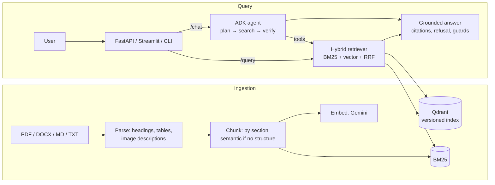

# DocQA: Agentic RAG for Vietnamese documents

DocQA answers questions about a folder of documents (PDF, Word, Markdown, text) **in Vietnamese, with citations**, and says *"Tôi không tìm thấy thông tin này trong tài liệu đã cung cấp."* when the documents do not contain the answer.

It is built with **LlamaIndex** (ingestion, indexing, retrieval), **Google ADK** (the agent) and **Qdrant** (vector store), and every design choice is backed by a measurement on public benchmarks or on labelled real documents.

## Highlights

- **Structure-aware chunking** (headings, tables kept row by row, section path embedded with every chunk) raised retrieval **Hit@1 from 64% to 79%** on real Vietnamese documents.
- **Hybrid retrieval** (BM25 + dense vectors, Reciprocal Rank Fusion) on a custom LlamaIndex retriever over Qdrant.
- **Agentic RAG**: an ADK agent plans sub-questions, searches, re-searches and verifies its cited answer. LlamaIndex retrieval is exposed to it as tools.
- **Grounded answers**: mandatory citations, a calibrated similarity gate, an LLM-as-judge check, and refusal when the documents are silent.
- **Prompt-injection defence** in four layers, with the pattern detector measured on a third-party dataset rather than on its own attacks.
- **Evaluation on public Vietnamese benchmarks**: Zalo AI 2021 Legal Text Retrieval (retrieval) and UIT-ViQuAD 2.0 (token-level chunking metrics).

## Contents

- [How it works](#how-it-works)
- [Results](#results)
- [Quickstart](#quickstart)
- [Reproducing the evaluation](#reproducing-the-evaluation)
- [Configuration](#configuration)
- [API](#api)
- [Development](#development)
- [Limitations](#limitations)

## How it works



**How LlamaIndex and Google ADK fit together.** LlamaIndex owns the data path: parsing, chunking, the `VectorStoreIndex` on Qdrant, and a custom `HybridRetriever` (a LlamaIndex `BaseRetriever`). The ADK agent never touches the index directly: it calls thin Python tools (`search_passages`, `read_context`, `check_answer`) that return **evidence passages with ids**, and the agent reasons over them and cites them. The one-shot endpoint `/query` uses the same engine without the agent, as a cheaper baseline.

| Stage | What happens | Code |
|---|---|---|
| Parsing | Word heading styles, Markdown `#` and numbered headings (`2.1`, `Chương II`, `Điều 5`) become sections; tables become one `header: value` line per row; images are described by Gemini vision (optional) | `structure.py`, `images.py` |
| Chunking | One chunk set per section with its heading path; semantic chunking (sentence-window cosine breakpoints) for files without structure | `structure.py`, `semantic.py` |
| Indexing | Incremental sync by content hash; every write creates a new index version and switches an atomic `CURRENT` pointer; quota-aware embedding | `engine.py`, `storage.py` |
| Retrieval | BM25 + vector, fused with RRF, optional per-document filter | `retrieval.py` |
| Generation | Numbered excerpts, mandatory `[n]` citations, similarity gate, refusal detection | `prompts.py`, `engine.py` |
| Agent | Plan, search (≤ 3 per sub-question), read neighbouring chunks, draft with `[#id]`, verify once, answer; LLM-call limit and citation checks enforced in code | `agent.py`, `chat.py` |
| Security | Spotlighting, output guard, tool permission, sanitisation (`INJECTION_DEFENSE`) | `injection.py` |

Design rationale for each decision, including what did not work: [docs/design-decisions.md](docs/design-decisions.md). Layer-by-layer detail: [docs/architecture.md](docs/architecture.md).

## Results

All numbers below come from runs in this repository. Commands to reproduce them are in [Reproducing the evaluation](#reproducing-the-evaluation).

### 1. Chunking on real documents

Public benchmarks ship text that is already split into passages, so they cannot test parsing, tables or figures. This set has 56 answerable questions over a 30-page Vietnamese `.docx` (46 headings, 12 tables) and a 49-slide `.pdf`. Each question is tagged by where its answer lives, and all of them were written **before** the new chunker existed. The set is not committed, because the documents are private or third-party. Hybrid retrieval, top 5:

| Answer located in | n | Hit@1, sentence → structure | MRR@5, sentence → structure |
|---|---|---|---|
| body text | 30 | 80.0% → **90.0%** | 0.883 → **0.939** |
| a table | 12 | 66.7% → **83.3%** | 0.750 → **0.917** |
| a named section | 7 | 57.1% → **100%** | 0.671 → **1.000** |
| a figure only | 7 | 0% → 0% | 0 → 0 |
| **all** | 56 | **64.3% → 78.6%** | **0.718 → 0.824** |

Every miss of the old chunker came from lost structure: a list cut off from its heading, a table without its caption, table cells detached from their columns. Figures stay at 0% because their text is never extracted; image descriptions (`IMAGE_CAPTIONS`) address that, and their effect has not been measured yet.

### 2. Chunk size and boundaries at token level (UIT-ViQuAD 2.0)

Hit@k does not penalise irrelevant text inside a chunk, so chunking is also measured token by token against human-labelled answer sentences, using the metrics of Chroma's *Evaluating Chunking Strategies for Retrieval* (2024). Data: 2,653 answerable questions of the UIT-ViQuAD 2.0 validation split, with the 19 Wikipedia articles rebuilt from their paragraphs. Retrieval is BM25, top 5. Precision Ω is the precision obtained when exactly the chunks that contain the answer are retrieved, so it measures the chunk boundaries independently of the retriever.

| Chunking | Tokens / chunk | Precision Ω | Recall@5 | IoU@5 |
|---|---|---|---|---|
| **paragraph boundaries** | 365 | **0.222** | **0.918** | 0.038 |
| sentence splitter 256 / overlap 0 | 212 | 0.360 | 0.858 | 0.062 |
| sentence splitter 512 / overlap 0 | 459 | 0.167 | 0.901 | 0.030 |
| sentence splitter 512 / overlap 64 | 457 | 0.165 | 0.909 | 0.030 |
| sentence splitter 512 / overlap 128 | 459 | 0.152 | 0.910 | 0.030 |
| sentence splitter 1024 / overlap 0 | 929 | 0.083 | 0.924 | 0.015 |

- **Natural boundaries beat fixed-size chunks on both axes.** Paragraph chunks are smaller than 512-token chunks, yet have higher recall and higher precision. This is the idea behind structure-aware chunking, confirmed on public data.
- **Overlap barely helps.** 512/128 creates 22% more chunks than 512/0 for +0.9 points of recall, and lowers precision.
- Wikipedia articles here have paragraphs but no headings, so this benchmark cannot test heading-based chunking; set 1 does.

### 3. Retrieval on Zalo AI 2021 Legal Text Retrieval

61,425 legal articles and 788 human-labelled test questions, in BEIR format. Each article is one passage, so this measures retrieval, not chunking. Values are means with 95% bootstrap confidence intervals.

| Retriever | nDCG@10 | MRR@10 | Recall@1 | Recall@10 | Recall@100 |
|---|---|---|---|---|---|
| BM25, full corpus | 0.628 [0.602–0.654] | 0.562 | 0.417 | 0.834 | 0.968 |

Dense and hybrid retrieval need one embedding per article, so they run on a seeded subset (all relevant articles of 100 sampled questions plus 1,500 random distractors). These results are pending. Subset scores are only compared with each other, never with full-corpus numbers.

### 4. Agentic vs one-shot RAG

Demo corpus (12 chunks), Gemini `gemini-3.5-flash-lite`. The sample is small, so these are observations, not significant differences.

| Questions | One-shot RAG | Agentic RAG |
|---|---|---|
| 10 multi-hop, top-k 4 | 100%, 0.9 LLM calls, 4.3 s | 100%, 4.1 LLM calls, 23 s |
| 10 multi-hop, top-k 2 (narrow retrieval) | 90%, 1.0 LLM calls, 1.5 s | **100%**, 3.5 LLM calls, 17 s |
| 7 out-of-scope | 100% correct refusal | 100% correct refusal |

The agent costs about 4× the LLM calls. It pays off only when a single retrieval cannot see all the evidence, so one-shot RAG (`/query`) is the default and the agent (`/chat`) serves conversation and multi-part questions.

### 5. Prompt injection

| Layer | Protects against | Setting |
|---|---|---|
| Spotlighting: excerpts wrapped in tags with a random per-request nonce, declared as data only | Instructions hidden in documents | `spotlight`, `full` |
| Output guard: links not present in the excerpts are removed; answers that reproduce the system prompt are withheld | Phishing links, prompt extraction | `spotlight`, `full` |
| Tool permission: `sync_documents` runs only if the user's own message asks for it (checked in code) | Tool hijacking | `spotlight`, `full` |
| Sanitisation: sentences addressing the AI or overriding it are replaced before the model sees them | Known injection phrasings (vi, en) | `full` |

The pattern detector is measured on data it was not developed on:

| Data | Detection rate | False positives |
|---|---|---|
| [deepset/prompt-injections](https://huggingface.co/datasets/deepset/prompt-injections), held-out test split (60 attacks, 56 benign) | 26.7% | 0% |
| 718,149 clean Vietnamese sentences (legal texts, Wikipedia, company documents) | – | 0.0003% |

The detector is precise but catches only about a quarter of unseen attacks. That is why the three structural layers, which do not need to recognise an attack, carry most of the defence. End-to-end attack success rates on a focused 30-case suite adapted from BIPIA and AgentDojo (six payload types: instruction override, phishing link, false claim, prompt extraction, tool hijacking, denial of service) are pending.

## Quickstart

Requirements: Python 3.11+ and a Gemini API key from [Google AI Studio](https://aistudio.google.com/app/apikey), or [Ollama](https://ollama.com) for local models.

```bash
python -m venv .venv
# Windows: .venv\Scripts\activate    Linux/macOS: source .venv/bin/activate
pip install -e ".[dev,ui,qdrant]"     # add ,ollama for local models
cp .env.example .env                  # set GOOGLE_API_KEY; CHUNK_STRATEGY=structure is recommended
```

Index the demo documents (a fictional company in `data/demo/`) and ask a question:

```bash
docqa rebuild
docqa ask "Định mức khách sạn khi công tác ở TP.HCM là bao nhiêu?"
```

```text
Định mức khách sạn tại Hà Nội và TP. Hồ Chí Minh tối đa 1.200.000 đồng mỗi đêm [1].
 *[1] demo/quy_trinh_cong_tac_va_hoan_ung.md  score=0.0325
```

*(Illustrative output: the wording depends on the model.)*

Other ways to run it:

| Interface | Command |
|---|---|
| REST API (docs at `/docs`) | `docqa serve` → http://127.0.0.1:8000 |
| Chat UI | `streamlit run ui/streamlit_app.py` → http://localhost:8501 (needs the API) |
| ADK developer UI | `adk web agents`, then pick `docqa_agent` |
| Docker Compose (Qdrant, API, UI) | `docker compose up --build` |

**Local models.** Set `LLM_PROVIDER=ollama`, `LLM_MODEL=qwen2.5:7b`, `EMBED_PROVIDER=ollama` and `EMBED_MODEL=embeddinggemma` after `ollama pull` of both models. `/query` and `docqa ask` then run fully locally; the ADK agent still uses `ADK_MODEL` (Gemini).

**Example questions on the demo data**

| Question | Expected behaviour |
|---|---|
| Sinh viên thực tập từ mấy giờ đến mấy giờ? | Mon–Fri, 8:30–17:30, with a citation |
| Phụ cấp trực hệ thống mỗi tuần là bao nhiêu? | 1,000,000 VND per on-call week, answered from the `.docx` file |
| *(agent, follow-up)* Còn sự cố P1 thì phải xác nhận trong bao lâu? | The agent rewrites it as a standalone question → 15 minutes |
| Thủ đô của nước Pháp là gì? | Refusal: out of scope |

## Reproducing the evaluation

```bash
python scripts/download_benchmarks.py            # Zalo Legal, UIT-ViQuAD 2.0, deepset injections → data/benchmarks/
```

| Result | Command | API cost |
|---|---|---|
| 1. Chunking on real documents | `CHUNK_STRATEGY=structure docqa eval --dataset <set>.jsonl --retrieval-only --k 5` | Embeddings |
| 2. Token-level chunking | `docqa chunk-bench data/benchmarks/viquad2/data/validation-00000-of-00001.parquet` | None |
| 3. Zalo Legal, BM25 full corpus | `docqa bench data/benchmarks/zalo_legal --modes bm25` | None |
| 3. Zalo Legal, dense and hybrid | `docqa bench data/benchmarks/zalo_legal --modes bm25,vector,hybrid --queries 100 --distractors 1500` | ~1,600 embeddings, cached on disk |
| 4. Agentic vs one-shot | `docqa eval --agent --kinds multi_hop,unanswerable --delay 4` | LLM calls |
| 5. Injection detector | `docqa injection-detector` | None |
| 5. Attack success rate | `docqa injection-eval --modes oneshot,agent --defenses off,spotlight,full --delay 4` | LLM calls |

`docqa eval` uses the labelled demo set [eval/dataset.jsonl](eval/dataset.jsonl) by default: 34 single-hop, 10 multi-hop and 7 out-of-scope questions. It reports Hit@k and MRR per retrieval mode and per question tag; answer accuracy, refusal and citation rates; LLM-as-judge faithfulness; cost (LLM calls) and latency, for one-shot RAG and the agent side by side; and a suggested `MIN_SIMILARITY` from the score distributions. Reports are written to `eval/results/`.

Datasets: [Zalo Legal (MIT)](https://huggingface.co/datasets/GreenNode/zalo-ai-legal-text-retrieval-vn); [UIT-ViQuAD 2.0 mirror](https://huggingface.co/datasets/taidng/UIT-ViQuAD2.0) of the VLSP 2021 dataset (the official release is available from the UIT NLP group); [deepset/prompt-injections (Apache-2.0)](https://huggingface.co/datasets/deepset/prompt-injections). They are downloaded locally and are not redistributed in this repository.

## Configuration

All settings come from environment variables or `.env`; see [.env.example](.env.example).

| Variable | Default | Purpose |
|---|---|---|
| `LLM_PROVIDER` / `LLM_MODEL` | `google` / `gemini-3.5-flash-lite` | Answer generation and image descriptions |
| `EMBED_PROVIDER` / `EMBED_MODEL` | `google` / `gemini-embedding-2` | Embeddings |
| `ADK_MODEL` | `gemini-3.5-flash-lite` | Model of the agent |
| `VECTOR_STORE` | `simple` | `simple` (JSON, zero setup) or `qdrant` |
| `QDRANT_URL` / `QDRANT_API_KEY` | – | Qdrant server; empty means embedded mode in `storage/qdrant` (one process at a time) |
| `CHUNK_STRATEGY` | `sentence` | `sentence`, `semantic` or `structure` (recommended) |
| `STRUCTURE_FALLBACK` | `semantic` | How `structure` splits files without headings: `semantic` or `sentence` |
| `CHUNK_SIZE` / `CHUNK_OVERLAP` | `512` / `64` | Chunk size in tokens |
| `IMAGE_CAPTIONS` / `MAX_IMAGES_PER_FILE` | `false` / `40` | Describe images at ingestion (cached in `storage/captions`) |
| `RETRIEVAL_MODE` | `hybrid` | `vector`, `bm25` or `hybrid` |
| `CANDIDATE_TOP_K` / `TOP_K` / `RRF_K` | `8` / `4` / `60` | Candidates per retriever, chunks given to the LLM, fusion constant |
| `MIN_SIMILARITY` | `0.55` | Similarity gate before the LLM is called (calibrated for `gemini-embedding-2`) |
| `INJECTION_DEFENSE` | `off` | `off`, `spotlight` or `full` |
| `AGENT_MAX_LLM_CALLS` | `15` | LLM-call limit per agent turn |
| `AUTO_SYNC` | `true` | Sync the data folder when a process first loads the index |
| `DOCQA_API_KEY` | – | Protects write endpoints when set |
| `NLTK_DATA` | – | Private folder for the sentence-tokenizer data. NLTK refuses data from directories other accounts can write, such as a shared `site-packages`; Docker and CI set it and pre-download `stopwords` and `punkt_tab` |

Changing the embedding model or any chunking setting triggers an automatic index rebuild.

## API

| Method | Path | Description |
|---|---|---|
| `GET` | `/health`, `/stats` | Liveness and index statistics |
| `POST` | `/query` | `{question}` → `{status, answer, sources[], reason, latency_ms}` |
| `POST` | `/chat` | `{message, session_id?}` → agent answer, sources, the steps taken (tool, arguments, result) and the number of LLM calls; keeps the conversation per session |
| `GET` | `/documents` | Indexed documents |
| `POST` | `/documents` | Upload and index a file \* |
| `DELETE` | `/documents/{path}` | Delete a file and remove it from the index \* |
| `POST` | `/index/sync`, `/index/rebuild` | Incremental sync or full rebuild \* |

\* Requires the `X-API-Key` header when `DOCQA_API_KEY` is set.

## Development

```bash
pytest                                    # 152 tests, offline: fake embeddings and LLM, no API key
ruff check . && ruff format --check .
```

The tests cover parsing and chunking, RRF maths, prompts and refusals, incremental sync and crash safety, the Qdrant backend, the API, the agent tools, multi-turn chat through the real ADK `Runner` driven by a scripted model, the injection defences, and the evaluators.

```text
src/docqa/
  config.py, providers.py     Settings from env, Gemini or Ollama models
  documents.py                File discovery and loading, stable ids
  structure.py                Structure-aware parsing: sections, tables, heading paths
  semantic.py                 Semantic chunking
  images.py                   Image extraction, filtering and cached descriptions
  engine.py, storage.py       Ingestion, versioned index, query; quota-aware embedding
  retrieval.py                HybridRetriever (BM25 + vector + RRF)
  prompts.py                  Grounded prompt, citations, refusal detection
  agent.py, chat.py           ADK agent, tools and multi-turn chat with guardrails
  injection.py                Prompt-injection defences
  evaluation.py               Own-set evaluation: retrieval, answers, calibration
  benchmarks.py, ir_metrics.py  BEIR benchmarks (Zalo Legal), nDCG/MRR/Recall, bootstrap CIs
  chunk_eval.py               Token-level chunking metrics (UIT-ViQuAD 2.0)
  injection_eval.py           Injection detector and attack-success-rate suite
  api/app.py, cli.py          FastAPI app, `docqa` command
agents/docqa_agent/           ADK entry point for `adk web` / `adk run`
ui/streamlit_app.py           Chat UI
scripts/                      Benchmark download
data/demo/                    Fictional company documents
eval/dataset.jsonl            Labelled demo evaluation set
docs/                         Architecture and design decisions
```

## Limitations

- **Pending measurements:** dense and hybrid retrieval on Zalo Legal, end-to-end attack success rates, and the retrieval gain from image descriptions. `sentence` stays the default chunking strategy until `structure` has also passed a hybrid regression check on the demo set.
- PDF headings are not detected yet; PDFs are split by page, or semantically with `CHUNK_STRATEGY=structure`.
- BM25 splits Vietnamese by syllable. A word segmenter (as used in Zalo challenge solutions) is likely to help and can be measured for free on the full Zalo corpus.
- There is no reranker yet.
- The Docker Compose file and the GitHub Actions workflow (lint, tests on Python 3.12 and 3.13, Docker build) are included, but the Docker setup has not been verified end to end.
- `/chat` sessions live in memory, and there are no per-user document permissions.
- Image descriptions send images to the LLM provider and cost one call per new image.
